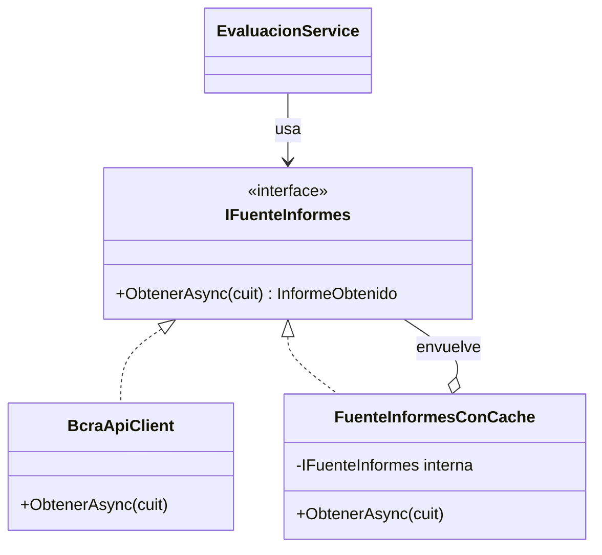

# SistemCheck

Evaluador de riesgo comercial para PYMEs. A partir de un CUIT/CUIL consulta la Central de Deudores
del BCRA y emite un semáforo que indica si conviene vender a crédito.

## Cómo ejecutarlo

Requiere el SDK de .NET 10 y un servidor MySQL 8.

1. Copiá `.env.example` como `.env`, en la raíz del proyecto, y completá tu usuario y contraseña de
   MySQL. El `.env` está en `.gitignore`, así que las credenciales no se suben.

2. Iniciá la aplicación. Las tablas se crean solas con las migraciones de EF Core. La base `sistemcheck`
   también, aunque podés crearla antes con `CREATE DATABASE sistemcheck;`:

   ```bash
   dotnet run --project src/SistemCheck.Web
   ```

   Si al iniciar aparece `Access denied for user`, falta el `.env` o la contraseña no es correcta.

- Aplicación web: http://localhost:5252 (hay que crear una cuenta en "Registrate")
- Documentación de la API (Swagger): http://localhost:5252/swagger

Los tests no necesitan MySQL, porque usan SQLite en memoria. Para correrlos:

```bash
dotnet test
```

## Patrón de diseño: Decorator

El caché de 24 horas está resuelto con el patrón **Decorator**: agrega comportamiento a un objeto
envolviéndolo con otro que implementa la misma interfaz.



| Rol del patrón | Clase | Responsabilidad |
| --- | --- | --- |
| Componente | `IFuenteInformes` | Contrato para obtener un informe |
| Componente concreto | `BcraApiClient` | Consulta la API del BCRA con `HttpClient` |
| Decorador | `FuenteInformesConCache` | Busca en MySQL y, si no hay un informe vigente, delega en la fuente interna |
| Cliente | `EvaluacionService` | Usa la interfaz, sin saber si hay caché |

El ensamblado se hace en un solo lugar, la inyección de dependencias de `Program.cs`.

**Por qué este patrón:**

- `BcraApiClient` no sabe nada de la base de datos, y el decorador no sabe nada de HTTP.
- `EvaluacionService` no cambia si se quita o se reemplaza el caché.
- El caché se prueba sin red, envolviendo una fuente falsa.
- Se podrían sumar más decoradores (por ejemplo, de logging o reintentos) sin tocar lo existente.

## Arquitectura

| Capa | Carpeta | Contenido |
| --- | --- | --- |
| Presentación | `Pages/` | Razor Pages: evaluación, historial y cuentas |
| API | `Api/` | Web API REST |
| Servicios | `Servicios/` | Caso de uso, cliente del BCRA y decorador de caché |
| Dominio | `Dominio/` | Validación de CUIT y reglas del semáforo |
| Datos | `Datos/` | EF Core con MySQL y migraciones |

## Reglas de negocio

Se toma la peor situación entre todas las entidades, en el último período informado.

| Situación | Semáforo | Resultado |
| --- | --- | --- |
| 1 | Verde | APROBADO |
| 2 | Amarillo | PRECAUCIÓN |
| 3 o más | Rojo | RECHAZADO |
| Sin deudas informadas | Amarillo | PRECAUCIÓN |

Los cheques rechazados sin pagar se avisan en el resumen, pero no cambian el semáforo. El monto
solicitado se registra y se muestra, pero tampoco interviene en el resultado.

## API REST

```
GET /api/evaluacion/{cuit}?monto=1500.50
```

`monto` es opcional. El CUIT se acepta con o sin guiones. La API es pública, sin autenticación, y sus
consultas no aparecen en el historial de ningún usuario.

| Código | Significado |
| --- | --- |
| 200 | Informe consolidado |
| 400 | CUIT o monto inválido |
| 503 | El BCRA no está disponible |

Ejemplo de respuesta (resumida):

```json
{
  "cuit": "30500010912",
  "denominacion": "BANCO DE LA NACION ARGENTINA",
  "semaforo": "Verde",
  "resultado": "APROBADO",
  "peorSituacion": 1,
  "deudaTotal": 329154542000.0,
  "chequesRechazados": 0,
  "desdeCache": false
}
```

## Temario cubierto

| Unidad | Tema | Dónde |
| --- | --- | --- |
| I | .NET 10 y C# | Toda la solución |
| II | Aplicación multicapa con Razor, Entity Framework y MySQL | `Pages/`, `Datos/` |
| III | Web API: consumo con `HttpClient` y exposición de endpoints REST | `Servicios/BcraApiClient.cs`, `Api/` |

## Datos del BCRA

- La API es pública y no requiere credenciales. [Catálogo de APIs del BCRA](https://www.bcra.gob.ar/BCRAyVos/catalogo-de-APIs-banco-central.asp).
- Las deudas vienen en miles de pesos y el cliente las convierte a pesos. Los cheques vienen en pesos.
- Un 404 significa que no hay datos para ese CUIT, no un error.
- El manual actual documenta las situaciones 1 a 5. La regla "3 o más" también cubre la 6, que pedía el
  enunciado original.
